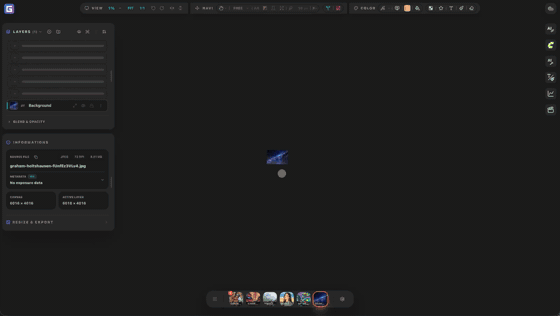

<p align="center">
  
</p>

<h1 align="center">OpenGPEX</h1>

<p align="center">
  <strong>Open-source, browser-native image editor built on a WebGPU rendering engine</strong><br/>
  Non-destructive editing · Plugin architecture · Optional client-side AI
</p>

<!-- ═══════════ Badges ═══════════ -->
<p align="center">
  
  <a href="./LICENSE"></a>
  
  
  
  
</p>

<!-- ═══════════ CTA ═══════════ -->
<p align="center">
  <a href="#-quick-start">Quick Start</a>&nbsp;&nbsp;|&nbsp;&nbsp;
  <a href="https://gpex.cloud">Web App</a>&nbsp;&nbsp;|&nbsp;&nbsp;
  <a href="#-plugin-system">Plugins</a>&nbsp;&nbsp;|&nbsp;&nbsp;
  <a href="./CHANGELOG.md">Changelog</a>
</p>

---

<!-- ═══════════ Hero ═══════════ -->
<p align="center">
  <a href="https://gpex.cloud">
    
  </a>
</p>

> [!NOTE]
> **Under active development** — OpenGPEX 2.x is a full WebGPU rewrite. Plugin APIs and document contracts may still change between minor releases. [Issues](https://github.com/gpex-cloud/opengpex/issues) and PRs are welcome!

---

## Architecture

OpenGPEX runs entirely in the browser — no server-side processing is involved in editing.

```
┌────────────────────────────────── Browser ──────────────────────────────────┐
│                                                                             │
│  UI (React 19 · Tailwind CSS v4)                                            │
│    │  commands · signals · slot contributions                               │
│  Plugin Runtime ── base plugins (tools, panels, drawers, overlays)          │
│    │    everything above the engine is a plugin                             │
│  Core Engine (TypeScript)                                                   │
│    ├─ Document model: edits are metadata — the source layer is              │
│    │  never modified; every operation is reversible                         │
│    ├─ State: Immer store with dual-track (fast/slow) updates                │
│    │  and volatile refs for high-frequency interaction paths                │
│    └─ Rendering: WebGPU render graph · tiled compositing ·                  │
│       OffscreenCanvas + Web Workers · isomorphic painter                    │
│                                                                             │
│  Format pipeline: WASM (wasm-vips · LibRaw · resvg · ghostpdl …)            │
│  AI (optional): ONNX Runtime Web / transformers.js — models are             │
│  downloaded on demand and inference runs client-side                        │
└─────────────────────────────────────────────────────────────────────────────┘
```

Key properties:

- **Non-destructive by construction** — the engine stores edit operations, not baked pixels. Erasing paints a mask, adjustments are re-computable, and undo/redo never degrades quality.
- **One rendering path** — the WebGPU render graph drives interactive playback and final export alike, so what you see is what you get, at interactive rates for 100MP+ documents.
- **Plugins are first-class** — tools, panels, drawers, and effects are all plugins speaking the same command/signal protocol as the built-ins.

## Features

### Core Editing
- **Layers** — multi-layer compositing, 16 blend modes, opacity/fill/lock/visibility
- **Brush & Eraser** — Catmull-Rom spline smoothing, adjustable size/opacity/hardness, stamp-based rendering
- **Non-destructive eraser** — erasing paints a mask instead of destroying pixels; Tab toggles Restore
- **Text** — inline contenteditable editing with IME (CJK) support, Google Fonts search, local font access
- **Transform** — move, scale (proportional/free), 8-direction handles

### Color & Adjustments (5-tab panel)
- **Basic** — brightness, contrast, saturation, hue rotate, blur
- **Curves** — RGB + per-channel cubic spline tonal control
- **Levels** — histogram-based, with auto-levels
- **Channel Mixer** — 3×3 matrix with 7 presets
- **Color Balance** — shadows/midtones/highlights shifts with preserve-luminosity

### Selection & Clipping
- **5 tools** — rectangle, ellipse, lasso, magic wand, SAM (AI segmentation)
- **Operations** — peel (cut to layer), stamp (copy to layer), invert, select from alpha, offset (expand/contract)
- **Feathering** with soft graduated edges

### AI Tools (Optional, Client-Side)
- **Background removal** — RMBG 1.4 / InSPyReNet Ultra
- **AI segmentation** — SAM 2.1 (point prompt + auto-segment)
- **AI eraser** — LaMa inpainting rebuilds the background behind removed objects
- **Super resolution** — 2× / 4× upscaling (Real-ESRGAN family, ONNX)
- **ComfyUI Bridge** — connect local/remote ComfyUI for custom workflows
- **LLM Image Bridge** — OpenAI-compatible API for text-to-image and editing

Models are downloaded on demand from HuggingFace and cached locally; nothing is bundled, and the built-in tools never send image data off your device.

### Documents & Export
- **Creation/Branch model** — trunk/branch hierarchy for AI multi-results and derived images
- **TabDock** — floating document dock with thumbnails and branch badges
- **Animated images** — animated GIF import, playback, re-export
- **Export** — JPEG, PNG, WebP, AVIF, TIFF (8/16/32-bit), animated GIF, BMP; quality/DPI/ICC/EXIF control

## Quick Start

Requirements: **Node.js 20+**, **pnpm**, and a WebGPU-capable browser (Chrome, Edge, or Safari).

```bash
git clone https://github.com/gpex-cloud/opengpex.git && cd opengpex && pnpm install && pnpm dev
```

Open **http://localhost:3040** — drag an image in to start editing.

<details>
<summary>Production build</summary>

```bash
pnpm build && pnpm start
```
</details>

## Plugin System

Everything above the engine is a plugin — tools, panels, drawers, overlays, and effects live in:

```
src/lib/opengpex/plugins/
├── base/         # Official plugins, registered into the core runtime
├── community/    # Community-contributed plugins
└── user/         # Local dev sandbox (kept out of release builds)
```

The plugin registry is generated by `scripts/sync-plugins.mjs` during `pnpm dev` / `pnpm install`; you don't edit it by hand.

Each plugin is a self-contained module with:

- **`commands`** — dispatchable actions with optional keyboard shortcuts
- **`signals`** — reactive state for cross-plugin communication
- **`component`** — React UI rendered into named slots
- **`interactions`** — gesture handlers with priority-based routing
- **`contributions`** — declarative slot/menu contributions

Plugins can be packaged and installed at runtime via ZIP upload through the Plugin Hub. See the [Plugin Development Guide](https://gpex.cloud/docs/plugin-overview).

## Tech Stack

| Layer | Technology |
|-------|-----------|
| Framework | Next.js 16 · React 19 |
| Rendering | WebGPU render graph · tiled compositing · OffscreenCanvas + Web Workers |
| State | Immer + custom store (dual-track fast/slow, volatile refs) |
| Styling | Tailwind CSS v4 |
| AI/ML | ONNX Runtime Web · transformers.js |
| Formats | wasm-vips · LibRaw-Wasm · resvg-js · ghostpdl-wasm · libheif · @jsquash/avif · gifenc · gifuct-js |
| Animation | Framer Motion · GSAP |
| Cloud (optional) | Cloudflare R2 + D1 + Workers |

## Contributing

Contributions are welcome! See [CONTRIBUTING.md](./CONTRIBUTING.md) for details.

```bash
pnpm lint   # Run before committing
```

## Third-party AI Models

AI models are downloaded on demand from HuggingFace at the user's choice — they are not bundled, and no forced network requests are made:

| Model | Purpose | Source | License |
|-------|---------|--------|---------|
| RMBG 1.4 | Background removal | [briaai/RMBG-1.4](https://huggingface.co/briaai/RMBG-1.4) | BRIA RMBG-1.4 (non-commercial) |
| InSPyReNet Ultra | Background removal (high-quality edges) | [OS-Software/InSPyReNet-SwinB-Plus-Ultra-ONNX](https://huggingface.co/OS-Software/InSPyReNet-SwinB-Plus-Ultra-ONNX) | MIT |
| SAM 2.1 Hiera Tiny | AI segmentation | [onnx-community/sam2.1-hiera-tiny-ONNX](https://huggingface.co/onnx-community/sam2.1-hiera-tiny-ONNX) | Apache-2.0 |
| LaMa | Inpainting (AI eraser) | [Carve/LaMa-ONNX](https://huggingface.co/Carve/LaMa-ONNX) | See model repo |
| Real-ESRGAN (x4) | Super resolution | [SceneWorks/real-esrgan-onnx](https://huggingface.co/SceneWorks/real-esrgan-onnx) | See model repo |
| 2x-AnimeSharpV4 | Super resolution (2×, illustration) | [Kim2091/2x-AnimeSharpV4](https://huggingface.co/Kim2091/2x-AnimeSharpV4) | See model repo |

## Third-party Libraries

Pre-compiled WASM/JS libraries in `public/ext/` handle client-side format processing:

> [!NOTE]
> Next.js is configured with Cross-Origin Isolation headers (`COOP`/`COEP`) to enable `SharedArrayBuffer`, allowing multi-threaded WASM processing (e.g. for `wasm-vips`).

| Library | Purpose | License |
|---------|---------|---------|
| wasm-vips | TIFF codec (8/16/32-bit, multi-page), CMYK conversion, high-precision decode | MIT / LGPL-3.0 |
| LibRaw-Wasm | RAW decoding (CR2/NEF/ARW) | ISC |
| libheif-js (libheif + libde265 wasm) | HEIC/HEIF proxy decode (10/12-bit sources & environments without HEVC hardware decode; 8-bit Apple photos use the browser's native WebCodecs — no bundled codec) | LGPL-3.0 |
| @jsquash/avif (libavif + dav1d wasm) | AVIF encoding & high-depth decode (10/12-bit SDR / wide-gamut via the `avif-proxy` channel; 8-bit SDR uses the browser's native decoder — exact-pinned) | Apache-2.0 |
| resvg-js | SVG rasterization | MPL-2.0 |
| ghostpdl-wasm | PostScript/PDF processing | AGPL-3.0 |
| exifreader | Semantic metadata extraction (camera / GPS / DPI); ISOBMFF container structure (AVIF/HEIC bit depth, alpha, color, orientation) is parsed in-house | MPL-2.0 |
| piexifjs | JPEG/WebP EXIF injection | MIT |
| gifenc | GIF multi-frame encoding | MIT |
| gifuct-js | GIF decoding | MIT |
| polygon-clipping | Polygon boolean operations | MPL-2.0 |

## Privacy & Telemetry

OpenGPEX periodically checks for updates with anonymous telemetry (version, OS, and an irreversibly salted host hash) to alert you of new releases and security patches. No personal data, images, or canvas contents are ever collected.

You can disable update checks and telemetry at any time in the Preferences menu. See [TELEMETRY.md](./TELEMETRY.md) for full details.

## License

**GPL-3.0-only** — see [LICENSE](./LICENSE).

Third-party plugins loaded dynamically at runtime are independent works and may use any license. Plugins in the source tree are covered by GPL-3.0.

---

<p align="center">
  <sub>If OpenGPEX helps you, consider giving it a ⭐ — it keeps the project going!</sub>
</p>
